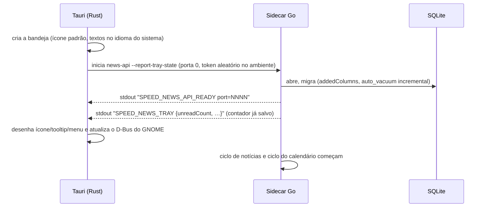
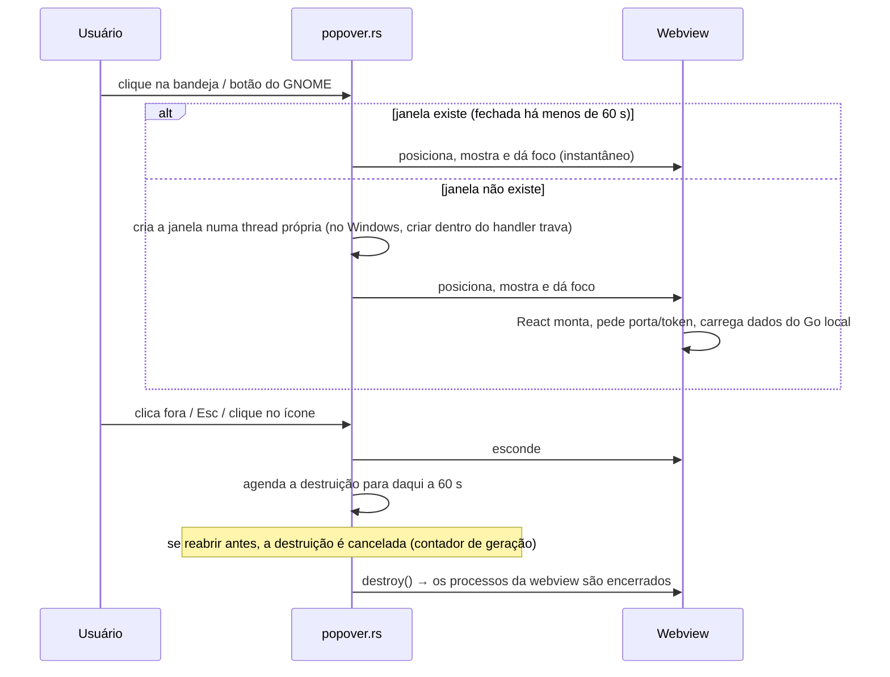

# Speed News — fluxos

> Como as peças conversam, em sequência. Complementa a [visão geral](visao-geral.md): lá está *o que* existe, aqui está *em que ordem* as coisas acontecem e *onde* cada passo mora no código.

## Mapa rápido: quem é dono de quê

| Pergunta | Dono | Onde |
|---|---|---|
| Quais notícias existem, quantas não lidas, quais configurações | **Go** (sidecar) | `apps/api/internal/news`, `storage/sqlite` |
| O que a bandeja mostra (ícone, contador, tooltip, menu) | **Rust**, alimentado pelo Go via stdout | `src-tauri/src/tray.rs`, `sidecar.rs` ← `internal/shellbridge` |
| Se a janela existe, aparece, some ou é destruída | **Rust** | `src-tauri/src/popover.rs` |
| Telas e formatação (fuso, idioma) | **React** | `apps/desktop/src/features/*` |
| Botão da barra do GNOME | **Extensão** ↔ Rust por D-Bus | `gnome-shell-extension/extension.js` ↔ `panel_bridge.rs` |
| Tudo o que acessa a internet | **Go** | `apps/api/internal/providers/*` |

Regra que guia o resto: **a webview é descartável.** Ela só existe enquanto o popover está aberto (mais 60 s de folga). Nada que precise continuar funcionando com o popover fechado pode depender dela.

### Pacotes do backend (`apps/api/internal`)

```
app/            monta tudo (composition root) e libera recursos após cada atualização
domain/         entidades: Article, RaceEvent, UserSettings…
sources/        lista de fontes (default_sources.yaml)
providers/      tudo o que acessa a internet, um subpacote por serviço externo
  rss/            feeds de notícias
  ogimage/        og:image de páginas de matéria (fontes sem imagem no feed)
  jolpica/        calendário e resultados
  f1circuits/     traçados e ficha dos circuitos
  openmeteo/      previsão do tempo
news/           serviço de notícias + normalização dos itens do feed
raceweekend/    "qual é o GP da semana", modo fim de semana
raceinsights/   abas Último GP, Pista e Clima (com cache)
jobs/           agendador: ciclo de notícias e ciclo do calendário, independentes
notifier/       transmite o contador (SSE e bandeja)
shellbridge/    contrato de stdout com o Tauri (estado da bandeja)
httpapi/        rotas por assunto: news.go, raceweekend.go, settings.go, events.go
storage/sqlite/ banco por agregado: articles, calendar, cache, settings, maintenance
fixtures/       o "mundo falso" usado pelos testes
```

---

## 1. Inicialização



- **Nenhuma janela é criada na inicialização** (`"create": false` em `tauri.conf.json`).
- A bandeja mostra o contador salvo logo de cara, sem esperar a primeira busca (que pode levar o timeout inteiro se uma fonte estiver fora do ar).
- Código: `lib.rs` (`setup`), `sidecar.rs` (`start_sidecar`, `parse_sidecar_line`), `cmd/news-api/main.go`, `app.Run`.

## 2. Notícia nova → contador → bandeja

```mermaid
sequenceDiagram
    participant Jobs as jobs.Scheduler
    participant News as news.Service
    participant Bus as notifier.Broadcaster
    participant Shell as shellbridge
    participant Rust as Tauri (Rust)
    participant UI as React (se aberto)
    Jobs->>News: RefreshAllSources (30 min; 5 min na semana de corrida)
    News->>News: busca as fontes em paralelo, normaliza, grava
    News->>Bus: Publish(unreadCount)
    Bus->>Shell: contador
    Shell->>Shell: lê as configurações (indicador, idioma, fechar ao clicar fora)
    Shell-->>Rust: stdout "SPEED_NEWS_TRAY {…}" (só se mudou algo)
    Rust->>Rust: tray::apply_sidecar_state → ícone, tooltip, menu, D-Bus
    Bus-->>UI: SSE /events (cabeçalho do popover)
    Jobs->>Jobs: depois de cada busca: checkpoint do WAL, fecha conexões ociosas, devolve memória ao SO
```

- O Broadcaster guarda sempre o **último** valor: um ouvinte lento perde valores intermediários, nunca o mais recente.
- "Mostrar novidades no ícone" desligado: o ícone e o botão do GNOME recebem 0, mas o tooltip e o cabeçalho do popover mantêm o número real (`SidecarTrayState::indicated_count`).
- Textos da bandeja em Rust (`tray_texts.rs`), espelhando `messages.ts`. Um teste do Vitest falha se divergirem.

## 3. Abrir e fechar o popover



- **Primeira abertura sem saltos** (a janela é nova toda vez):
  1. a janela nativa já nasce com a cor de fundo do app (`popover::app_background_color`, claro/escuro);
  2. o `index.html` traz o CSS por `<link>` e o **skeleton completo** em HTML estático, pintado antes de qualquer script (gerado de `src/StartupSkeleton.tsx` por `npm run generate:startup-skeleton`; um teste falha se divergir);
  3. React mostra o mesmo skeleton enquanto conecta e, no app, card e notícias trocam o skeleton pelo conteúdo **no mesmo lugar** (geometria igual, entrada suave `content-enter`, altura do card animada).
  O E2E `first paint is the app skeleton…` confere que a barra de filtros não se move do HTML estático até o conteúdo.
- Fechar a última janela normalmente encerraria o app. `RunEvent::ExitRequested` sem código (fechamento de janela) é ignorado; só "Sair", o botão ⏻ e o reinício do atualizador encerram de verdade (`popover::should_keep_running`).
- Proteções antigas que continuam valendo, com teste: "clique logo após perder o foco significa fechar" (400 ms), foco no evento de *map* no Linux.

### Onde o popover aparece (`placement.rs`, funções puras com testes por cenário)

1. **Âncora**, na ordem: o que foi clicado (área do ícone no Windows/macOS, ponto do clique no ksni/KDE, base do botão do GNOME) → a última área conhecida do ícone → a posição do cursor → canto superior direito do primeiro monitor.
2. **Monitor:** o que contém a âncora (senão, o mais próximo). Limita à **área útil** dele (sem barras e painéis), cortada aos limites do monitor.
3. **Direção:** abaixo da âncora se ela está na metade de cima do monitor (barra do GNOME, menu do macOS), acima se está na de baixo (barra de tarefas do Windows, painel inferior do KDE).
4. **Tamanho:** 380×620 lógicos do `tauri.conf.json` × escala do monitor de destino. O `outer_size()` da janela **não** é usado: numa janela GTK recém-criada ele vale 0×0 até o primeiro *map*, o que jogava o popover contra a borda na primeira abertura.
5. **Linux:** o `move` é feito na mesma closure GTK que mostra a janela, para a posição não chegar depois do `show`.

## 4. Mudança de configuração

1. A UI faz `PUT /settings` (Go valida e grava).
2. O handler republica o contador, o que acorda o `shellbridge`.
3. O `shellbridge` lê as configurações novas e emite uma linha nova para o Rust.
4. O Rust aplica: idioma dos textos, indicador no ícone e "fechar ao clicar fora" (`PopoverState`).

Por isso o Rust conhece "fechar ao clicar fora" mesmo antes de a webview existir. O único dado que vem da UI é o **locale do sistema** (`report_system_locale`), usado quando o idioma é "automático" e o ambiente não diz (macOS).

## 5. Atualização do app

- `updates.rs` verifica a cada 6 h.
- **AppImage / Windows / macOS:** baixa e espera o popover não estar visível (janela escondida *ou* inexistente), instala e reinicia.
- **.deb / .rpm:** baixa, guarda e emite `update-ready`. Como a webview pode não existir nesse momento, a UI também pergunta ao abrir (`pending_update`).

## 6. Manutenção de longo prazo

| Quando | O quê | Onde |
|---|---|---|
| Depois de cada busca de notícias | checkpoint `TRUNCATE` do WAL, `CloseIdleConnections`, `debug.FreeOSMemory` | `app/resources.go` |
| Uma vez por dia (na primeira busca após 24 h) | apaga `api_cache` com mais de 30 dias, `incremental_vacuum`, `PRAGMA optimize` | `storage/sqlite/maintenance.go` |
| A cada busca | apaga notícias com mais de 30 dias | `news.Service` |
| Sempre | limite de memória do Go em 48 MiB (soft), GC mais frequente | `cmd/news-api/main.go` |

O `TestRepeatedRefreshCyclesReachASteadyState` simula dezenas de ciclos e falha se goroutines, heap ou o arquivo do banco crescerem.

Para medir o app rodando: `make measure-memory` (Linux) ou `scripts\measure-memory.ps1` (Windows).

## 7. Onde mexer para…

| Quero… | Mexa em |
|---|---|
| adicionar uma fonte de notícias | `sources/default_sources.yaml` (+ fixtures) |
| mudar um texto da bandeja | `tray_texts.rs` **e** `messages.ts` (teste de paridade) |
| mudar o ícone | `tools/icon-generator`, depois `make icons` (teste de ouro compara os arquivos) |
| mudar o que a bandeja recebe do Go | `shellbridge.TrayState` **e** `tray::SidecarTrayState` (campos novos com padrão) |
| mudar o tempo até destruir a webview | `popover::DESTROY_AFTER_HIDDEN` |
| mudar onde o popover abre | `placement.rs` (acrescente o cenário aos testes) |
| mudar o layout do card, da lista ou do cabeçalho | ajuste também os skeletons e rode `npm run generate:startup-skeleton` |
| mexer no botão do GNOME | `extension.js` **e** `panel_bridge.rs`, mantendo `dev.speednews.Desktop1` compatível |
